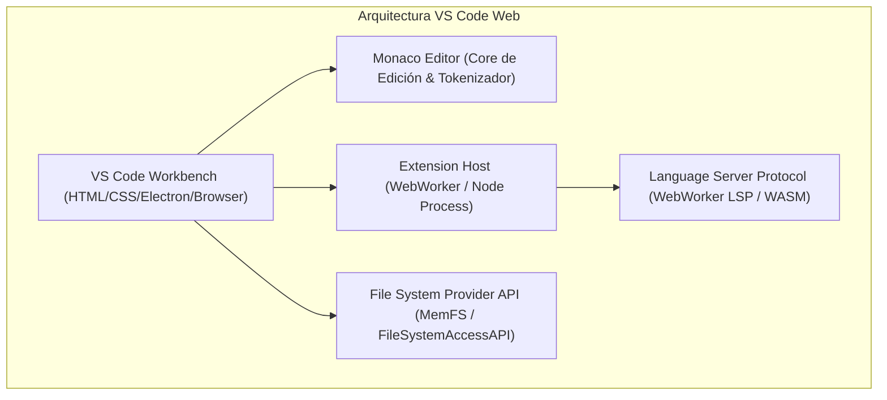
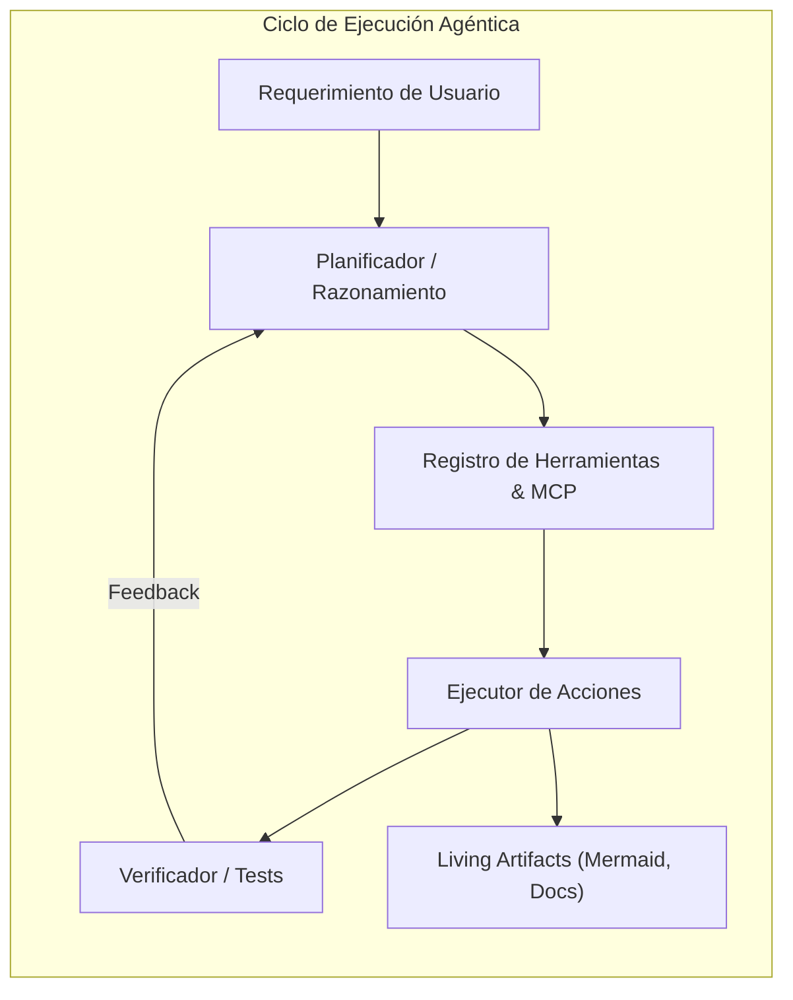

# Análisis Comparativo de Arquitectura para IDE en iPad Pro M2
**Proyecto:** REA-iPad-Agentic-IDE  
**Fecha:** 2026-10-30  
**Objetivo:** Deconstrucción técnica de Antigravity IDE, VS Code Web y apps nativas de iPadOS (Code App) para guiar el diseño del IDE de nueva generación.

---

## 1. Deconstrucción de VS Code y VS Code Web (code-server / vscode.dev)

VS Code es el entorno de desarrollo más utilizado del mundo. Su arquitectura modular desacopla la interfaz gráfica del motor de ejecución y lenguaje.

### Fortalezas deconstruidas
- **Monaco Editor:** Manejo ultra-eficiente de buffer de texto mediante árboles de segmentos (Piece Tree), renderizado virtualizado por viewport y resaltado sintáctico de alto rendimiento.
- **File System Access API:** Permite al navegador solicitar permisos de lectura/escritura sobre carpetas físicas del sistema operativo sin necesidad de backend local.
- **Protocolo LSP:** Estandarización de autocompletado, hover, diagnósticos y definiciones mediante comunicación JSON-RPC.

### Limitaciones en iPadOS
- Los atajos de teclado estándar entran en conflicto con atajos del sistema de iPadOS (ej: `Cmd+W`, `Cmd+H`, `Cmd+Espacio`).
- En iPadOS Safari, la gestión de memoria puede recargar pestañas en segundo plano si exceden el límite de WebView sin una estrategia agresiva de persistencia en disco o almacenamiento local.
- No dispone de una barra táctil nativa ergonómica para caracteres frecuentes de programación (`{`, `}`, `[`, `]`, `|`, `~`, `Tab`, `Esc`).

---

## 2. Deconstrucción de Antigravity IDE y Modo Agente

Antigravity representa la nueva era de IDEs centrados en agentes de inteligencia artificial y colaboración par a par (Pair Programming Agéntico).

### Fortalezas deconstruidas
- **Modo Agente Autónomo:** Capacidad del modelo de emitir llamadas a herramientas (`tool_calls`), recibir resultados y continuar en bucle hasta completar el objetivo.
- **Model Context Protocol (MCP):** Estandarización de clientes y servidores de herramientas que desacopla la IA de las herramientas específicas.
- **Living Artifacts & Sidecars:** Los resultados no son solo texto plano; se renderizan como documentos vivos con diagramas Mermaid, visualizaciones científicas e interfaces interactivas.

---

## 3. Deconstrucción de Apps iPadOS (Code App, Textastic, Blink Shell)

En la App Store de Apple existen herramientas notables para desarrollo en iPad:
- **Code App (de Thebas):** Implementa un entorno local emulando un shell POSIX mediante WebAssembly y empaqueta Monaco Editor dentro de un WKWebView con soporte para Node.js y Python locales vía Wasm.
- **Textastic:** Editor de código ultraligero nativo en Swift con soporte excelente de File Provider.
- **Blink Shell:** Cliente terminal y Mosh con integración a VS Code vía web y emulación de teclado de primera clase.

### Oportunidades no cubiertas por las apps actuales
1. **Falta de integración nativa profunda con agentes de IA:** Las apps existentes tienen chats superficiales o nulos, sin bucle agéntico autónomo, sin planificación y sin soporte de MCP.
2. **Sin aprovechamiento del chip Apple Silicon M2:** El chip M2 cuenta con arquitectura de memoria unificada (hasta 16GB con ancho de banda de 100 GB/s) y Neural Engine de 16 núcleos, ideal para ejecutar modelos locales o procesar razonamiento pesado sin cuellos de botella de bus.
3. **Ergonomía táctil fragmentada:** La mayoría de las apps obligan a usar teclado físico para ser productivo.

---

## 4. Síntesis y Visión de REA-iPad-Agentic-IDE

El nuevo IDE unifica lo mejor de los tres mundos:
1. **La potencia de edición de VS Code** con Monaco Editor y File System Access API para editar carpetas locales directamente.
2. **La capacidad multiagéntica de Antigravity** con soporte de modelos Gemini 2.5 Flash / Pro / Argon, herramientas MCP y Living Artifacts.
3. **La optimización nativa para iPad Pro M2:** Diseño Glassmorphic adaptado a pantallas Liquid Retina XDR ProMotion (120Hz), barra táctil de modificadores rápidos y capacidad dual PWA offline + contenedor nativo IPA.
