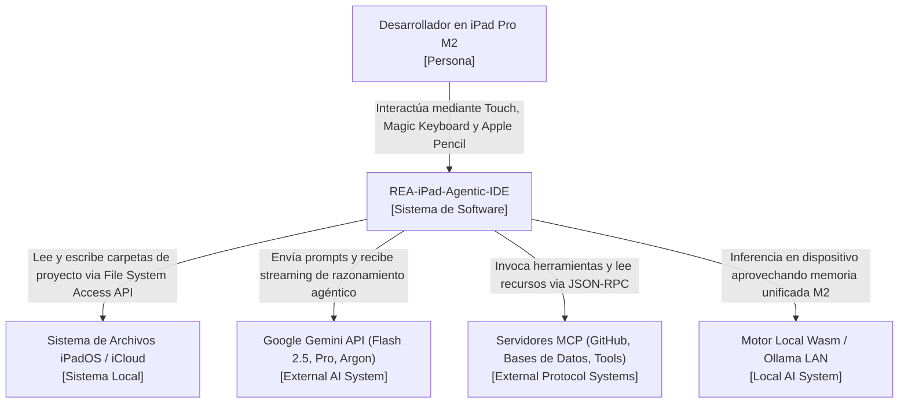
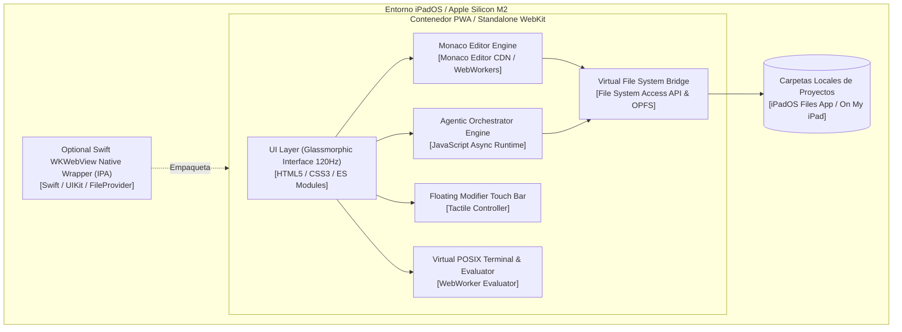
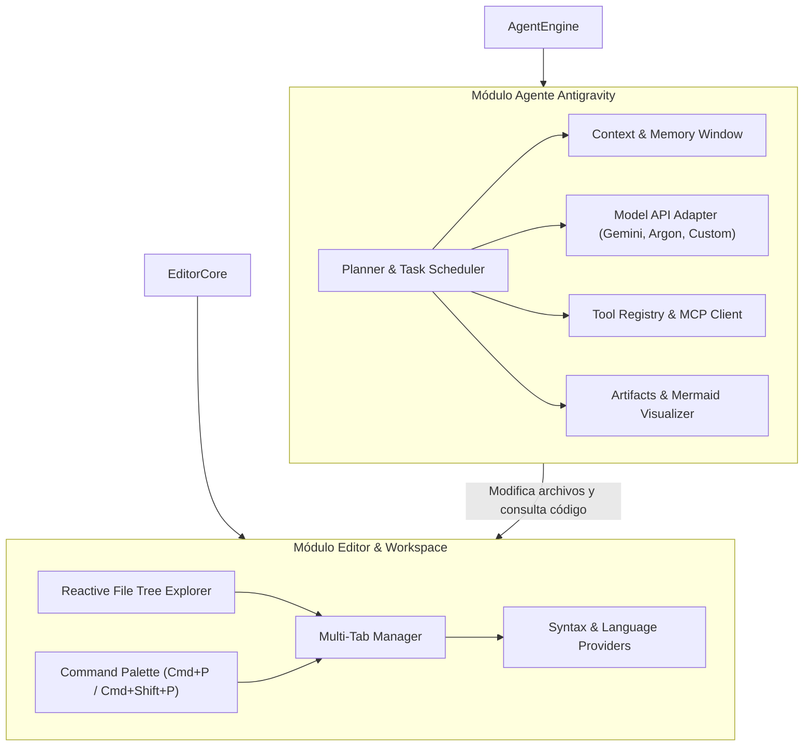

# Arquitectura C4 del Proyecto REA-iPad-Agentic-IDE
**Proyecto:** REA-iPad-Agentic-IDE  
**Fecha:** 2026-10-30

La arquitectura del sistema sigue el modelo C4 para documentar desde el contexto de alto nivel hasta la composición interna de los componentes del IDE.

---

## Nivel 1: Diagrama de Contexto de Sistema (System Context)

Muestra los usuarios que interactúan con el IDE y las conexiones externas (proveedores de modelos de IA, servidores MCP y almacenamiento del iPad).

---

## Nivel 2: Diagrama de Contenedores (Containers)

Descompone el IDE en sus contenedores lógicos de ejecución dentro de iPadOS.

---

## Nivel 3: Diagrama de Componentes (Components)

Detalle de los módulos internos del `AgentEngine` y del `EditorCore`.

