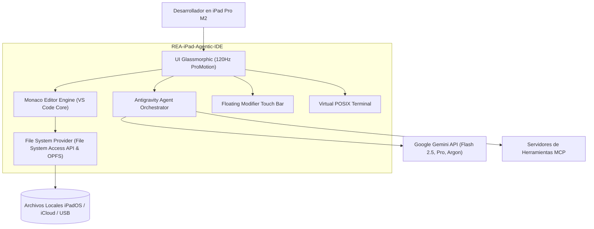

# REA-iPad-Agentic-IDE 🚀
> **Next-Gen Multilingual & Multi-Agentic IDE for Apple iPad Pro (Apple Silicon M2 / Unified Memory)**

[](LICENSE)
[]()
[]()
[]()

---

## 🌟 Descripción General

**REA-iPad-Agentic-IDE** es un entorno de desarrollo integrado (IDE) de última generación, deconstruido mediante la metodología **REA (Reverse Engineer Anything)** y diseñado específicamente para el factor de forma y arquitectura de **memoria unificada del procesador Apple Silicon M2** en el **iPad Pro**.

Combina:
1. **La potencia de edición de VS Code:** Monaco Editor virtualizado, resaltado sintáctico multilenguaje (TypeScript, Python, C/C++, HTML/CSS, JSON, Markdown, Rust, Go, SQL), minimapa y paleta de comandos.
2. **Acceso a Carpetas Reales:** Integración directa con el sistema de archivos de iPadOS / PC mediante la **File System Access API** (`showDirectoryPicker`) sin necesidad de servidores intermedios en la nube.
3. **Modo Agente Autónomo (Antigravity Mode):** Planificación en bucle, ejecución de herramientas y generación de **Living Artifacts** (diagramas Mermaid interactivos, contratos OpenAPI 3.1 y modelos DER).
4. **Ergonomía Táctil iPadOS:** Barra flotante de modificadores (`Esc`, `Tab`, `Ctrl`, `Alt`, `Cmd`, `{`, `}`, `[`, `]`, `|`, `~`, flechas) para programar a máxima velocidad sin depender obligatoriamente de un teclado físico.
5. **PWA Standalone & Contenedor Nativo:** Instalable en la pantalla de inicio a pantalla completa a 120Hz ProMotion o empaquetable como binario nativo IPA en Swift/WebKit.

---

## 📐 Arquitectura del Sistema



---

## 📂 Documentación Viva (`Docs/`)

- [**01-Analisis-Comparativo-IDE.md**](Docs/01-Analisis-Comparativo-IDE.md): Deconstrucción arquitectónica de Antigravity IDE, VS Code Web y apps nativas de iPadOS.
- [**02-Arquitectura-C4.md**](Docs/02-Arquitectura-C4.md): Modelado C4 en 4 capas (Contexto, Contenedores, Componentes).
- [**03-Especificacion-PRD.md**](Docs/03-Especificacion-PRD.md): Documento de Requerimientos de Producto con historias de usuario Gherkin.
- [**04-Registro-Decisiones-ADR.md**](Docs/04-Registro-Decisiones-ADR.md): ADRs (Monaco Editor, File System Access API, Agente Desacoplado, PWA vs IPA).
- [**05-Guia-Despliegue-iPadOS.md**](Docs/05-Guia-Despliegue-iPadOS.md): Guía paso a paso para abrir en red local, instalar como PWA y empaquetar nativamente.

---

## 🚀 Inicio Rápido

### 1. Ejecutar localmente en PC / Servidor
Si dispones de XAMPP o cualquier servidor estático:
```bash
# Vía XAMPP
http://localhost/REA/REA-iPad-Agentic-IDE/
```

### 2. Abrir en iPad Pro M2
1. Conecta tu iPad a la misma red Wi-Fi de tu PC.
2. Abre Safari y navega a `http://<IP-DE-TU-PC>/REA/REA-iPad-Agentic-IDE/`.
3. Pulsa **Compartir -> "Añadir a pantalla de inicio"** para usarla como App independiente a pantalla completa.

---

## 📄 Licencia
Este proyecto se distribuye bajo la licencia MIT.
